### P01 — Iniciar sense dades guardades
- **Passos realitzats:** S'ha netejat `localStorage` i cookies des de les DevTools (F12 -> Application) i s'ha recarregat la pàgina.
- **Resultat esperat:** Catàleg complet i selecció buida.
- **Resultat real obtingut:** Es mostren els 12 exercicis del catàleg, la sessió mostra "Encara no has seleccionat cap exercici", totals a 0 i botó de buidar desactivat. (Estat: **OK**).
- **Captura:** `img/proves/p01.png`

# Registre de proves — MyGymBro

| Cas     | Acció realitzada                                                         | Resultat esperat | Resultat real obtingut                                                                                                                           | Estat | Captures                                                                                                                                             |
|:--------|:-------------------------------------------------------------------------| :--- |:-------------------------------------------------------------------------------------------------------------------------------------------------| :--- |:-----------------------------------------------------------------------------------------------------------------------------------------------------|
| **P01** | Obrir la web amb el `localStorage` buit.                                 | Es mostra el catàleg complet i l'aside buit amb totals a 0. | Es carreguen tots els exercicis i l'aside indica que no hi ha selecció (0 exercicis, 0 min, 0 kcal).                                             | OK | 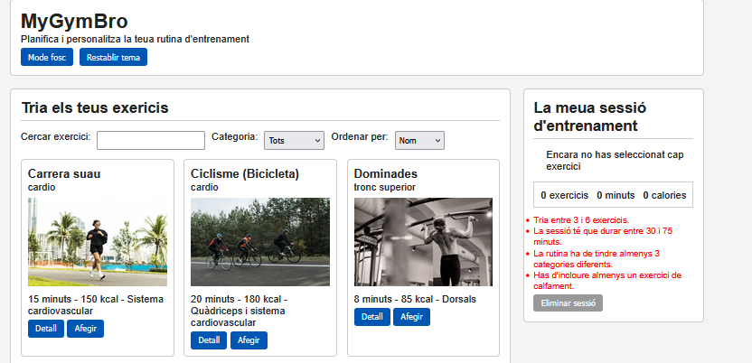                                                                                                        |
| **P02** | Cercar `"a"`, filtrar per `"calfament"` i ordenar per `"Durada"`.        | Només apareixen coincidències de calfament amb la lletra "a", ordenades de menys a més minuts. | Filtra correctament les coincidències i les ordena ascendentment per minuts.                                                                     | OK | 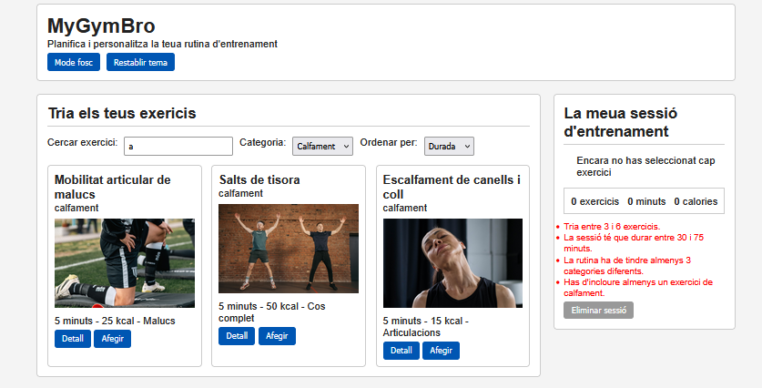                                                                                                        |
| **P03** | Escriure `"zzzzz"` al cercador i després esborrar-ho tornant a `"Tots"`. | Mostra avís de sense resultats i després recupera tot el catàleg. | Apareix "No hi ha exercicis amb aquests filtres" i en netejar es recuperen totes les fitxes.                                                     | OK | 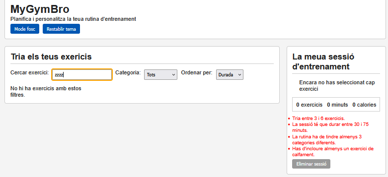                                                                                                        |
| **P04** | Prémer `"Detall"` en "Flexions i tancar amb `×`.                         | S'obri el modal amb foto, descripció i dades, i es tanca sense recarregar. | El `<dialog>` mostra la informació correcta i es tanca sense recarregar la pàgina.                                                               | OK | 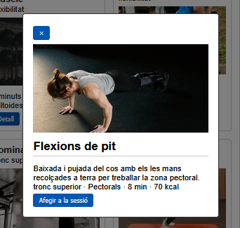                                                                                                        |
| **P05** | Prémer `"Afegir"` dues vegades seguides en el mateix exercici.           | Només s'afig una entrada a la llista de la sessió. | A l'aside només apareix una fila per a eixe exercici i els totals no es dupliquen.                                                               | OK | 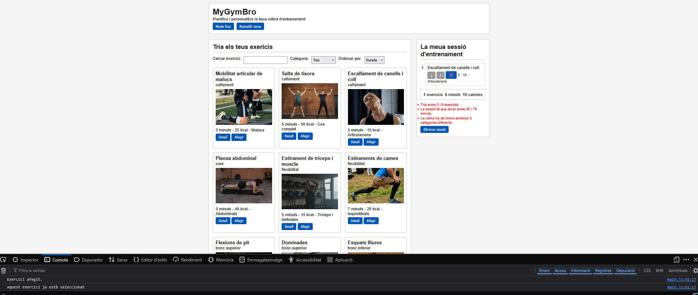                                                                                                        |
| **P06** | Amb 3 exercicis, prémer `↑`, arrossegar una fila i prémer `❌`.           | L'ordre canvia correctament i els sumatoris de minuts i calories s'ajusten. | Tant els botons com el Drag & Drop reordenen les files i en eliminar es recalculen els totals.                                                   | OK | 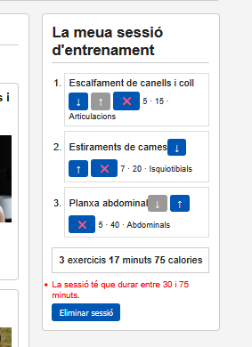 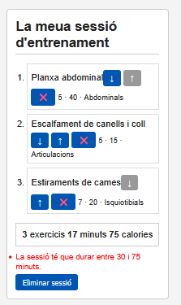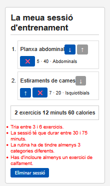 |
| **P07** | Provar selecció amb 2 exercicis, sense calfament, amb 1 sola categoria i després una combinació vàlida (4 exercicis, 3 categories, calfament inclòs, 45 min). | Els casos invàlids mostren el seu avís específic i bloquegen el botó; només el cas vàlid permet confirmar. | Cada regla ha mostrat el seu missatge d'error corresponent i només s'ha activat la confirmació en complir-les totes.                             | OK | 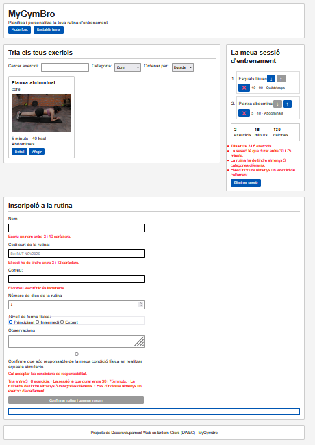 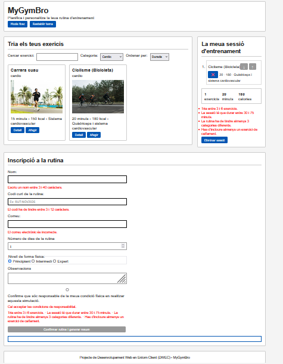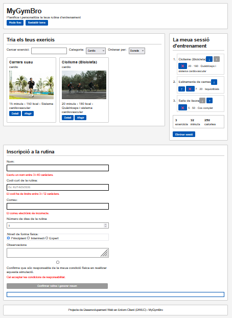 |
| **P08** | Introduir `7` dies a la setmana (límit màxim) i després `8`; provar també 6 exercicis (límit) enfront de 7 exercicis. | Amb `7` dies i `6` exercicis s'accepta; amb `8` dies i `7` exercicis es rebutja amb missatge d'error. | El límit exacte (`7` dies / `6` exercicis) s'accepta correctament i el valor superior (`8` / `7`) mostra error i desactiva el botó.              | OK | 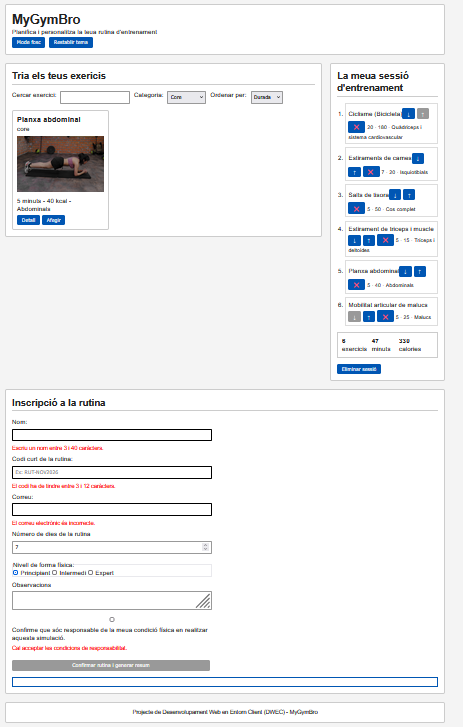 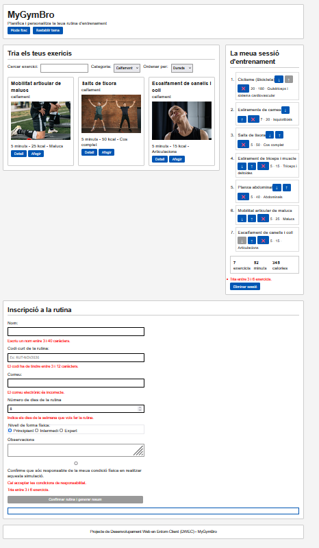                                                  |
| **P09** | Deixar camps buits, escriure només espais al nom, posar correu sense `@` i codi curt de 2 caràcters. | Es pinten els avisos en roig sota cada camp (`aria-invalid="true"`) i el botó continua desactivat. | Tots els camps incorrectes mostren el seu missatge clar en roig i impedeixen enviar el formulari.                                                | OK | 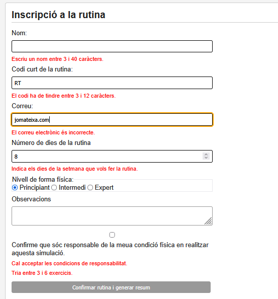                                                                                                        |
| **P10** | Enviar el formulari amb dades i sessió vàlides; tot seguit modificar el nom o eliminar un exercici. | Es genera el resum de confirmació i, en alterar qualsevol dada, el resum s'esborra. | El resum es mostra complet en confirmar i desapareix a l'instant en modificar un camp o l'aside.                                                 | OK | 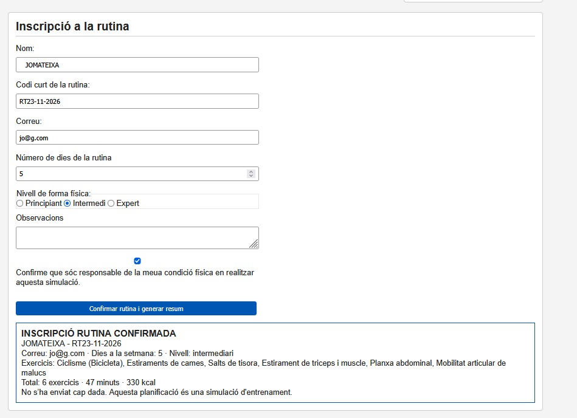   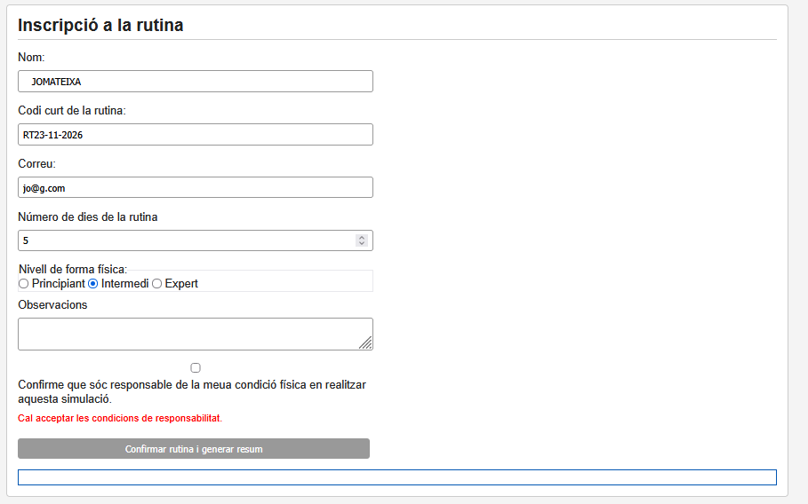                                                    |
| **P11** | Seleccionar 3 exercicis, reordenar-los i recarregar la pàgina (`F5`). | Es recuperen tots els exercicis seleccionats mantenint l'ordre modificat i els totals. | En recarregar, la sessió es restaura idèntica en contingut, ordre i comptadors.                                                                  | OK | 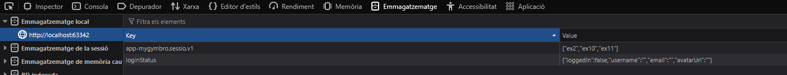                                                                                                        |
| **P12** | Manipular `localStorage` a F12 posant JSON mal format (`{trencat`) i després un array amb un ID inexistent i un duplicat (`["ex1","inventat","ex1"]`). | L'aplicació no peta, captura l'error amb `try/catch` i s'inicia sanejant les dades no vàlides. | Amb JSON corrupte arrenca buida sense bloquejar-se; amb dades manipulades descarta els IDs inexistents i duplicats.                              | OK |
| **P13** | Prémer el botó `"Eliminar sessió"` i recarregar el navegador (`F5`). | La sessió es buida tant a la pantalla com al `localStorage` i continua buida en recarregar. | En prémer el botó s'esborra la clau del `localStorage` i després de recarregar l'aside segueix buit.                                             | OK | 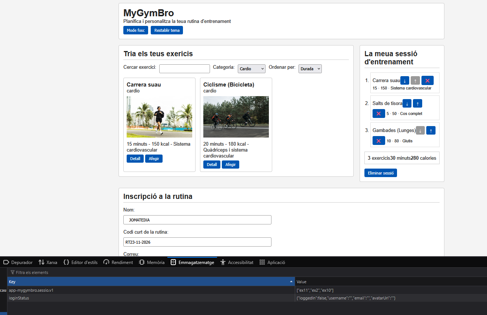 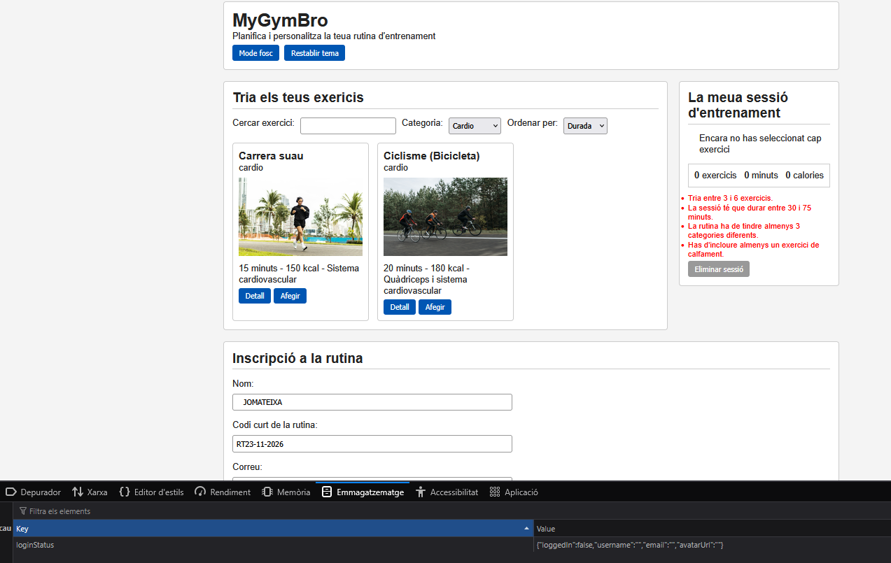                                                  |   
| **P14** | Activar `"Mode fosc"`, recarregar (`F5`) i després prémer `"Restablir tema"` i recarregar. | Es crea la cookie `tema_mygymbro=fosc`, persisteix en recarregar i s'elimina (`max-age=0`) en restablir. | La cookie es crea, manté el tema fosc entre recàrregues i s'esborra correctament en restablir.  | OK | 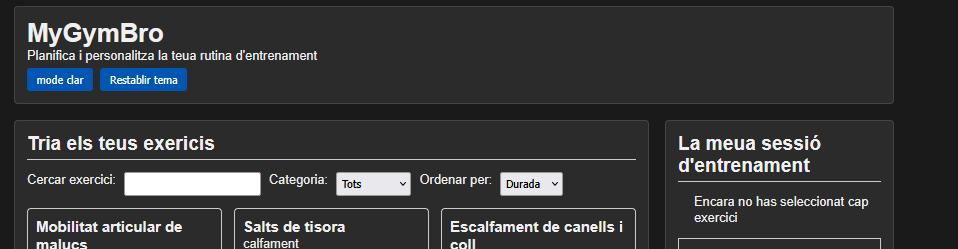 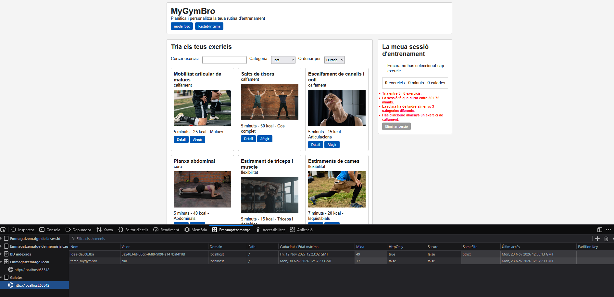                                                  | 
| **P15** | Comprovar les instàncies d'exercicis carregades des de `dades.js` al catàleg i als càlculs de la sessió. | Les dades d'exercicis s'instancien correctament i participen en tots els càlculs de temps i calories. | *(Nota: S'ha prioritzat l'arquitectura modular amb objectes estructurats en lloc d'herència amb `extends`; tots els exercicis es carreguen i operen sense errors).* | PARCIAL / OK |
| **P16** | Provar el flux complet de reordenació combinada (botons `↑`/`↓` i arrossegament *Drag & Drop*) i control d'estat buit. | Els elements es reordenen en ambdues direccions, els botons dels extrems es desactiven i el botó d'eliminar sessió s'habilita/deshabilita segons l'estat. | Comportament verificat: els botons dels límits es desactiven automàticament, el Drag & Drop mou qualsevol fila i en buidar la sessió es reinicien tots els controls. | OK |
| **P17** | Navegar per tota la interfície només amb el teclat (`Tab`, `Enter`, `Esc`), comprovar la vista mòbil (`< 800px`) i executar l'app en un segon navegador (Firefox/Edge). | Focus sempre visible, modal tancable amb `Esc`, disseny adaptat en una columna en mòbil i funcionament idèntic al segon navegador. | El focus taronja guia tot el recorregut per teclat, la vista mòbil apila els blocs sense desbordaments i el flux funciona igual en el segon navegador.  | OK | 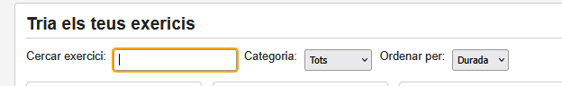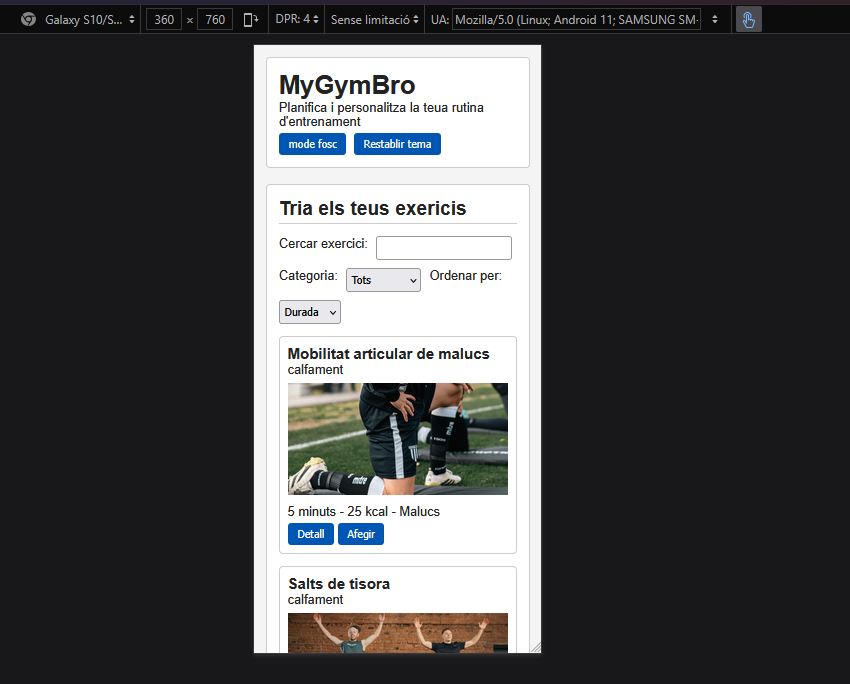                                                     | 
| **P18** | Simular una fallada d'escriptura llançant un `Error` dins del `try` de `guardarSessio()` a `persistencia.js` i afegir un exercici. *(Simulació retirada després de la prova)*. | Es registra l'avís a la consola (`console.error`) sense trencar l'execució i l'aplicació continua operant en memòria. | La consola mostra l'avís controlat pel `catch`, la funció retorna `false` i l'usuari pot continuar afegint exercicis i confirmant la rutina en memòria. | OK | 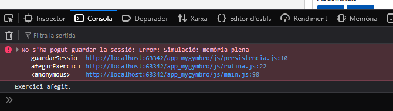                                                                                                        | 